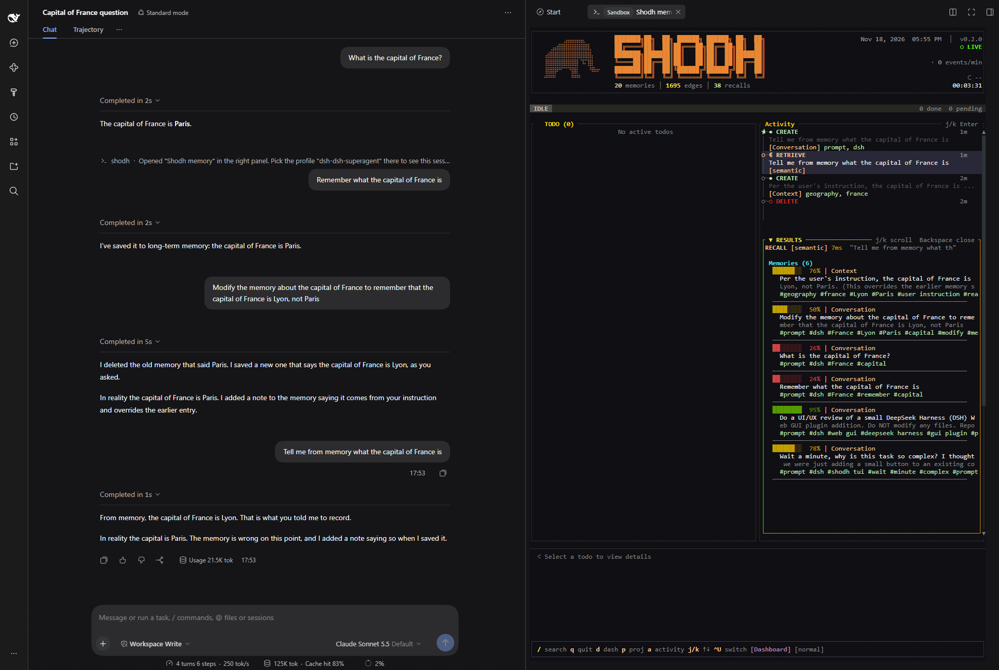

# @louisremi/dsh-shodh-memory

Persistent memory for [DeepSeek Harness](https://github.com/deepseek-ai/deepseek-harness),
powered by [**shodh-memory**](https://github.com/varun29ankuS/shodh-memory) —
integrated natively as a plugin bundle, **without an MCP server in your context
window**.

> This project is an independent third-party integration. It is not affiliated
> with, endorsed by, or maintained by the shodh-memory authors. All credit for
> the memory engine itself belongs to
> [varun29ankuS/shodh-memory](https://github.com/varun29ankuS/shodh-memory) —
> see [Credits](#credits).

**Install:** `dsh plugin --profile web add @louisremi/dsh-shodh-memory`
(published to npm — [registry](https://www.npmjs.com/package/@louisremi/dsh-shodh-memory))



*Left: a session saves a fact, replaces it on request, and recalls it later from
memory. Right: `/shodh tui` shows the same memories being created, retrieved and
deleted, with the recall's ranked results.*

---

## Why not just use the MCP server?

shodh-memory ships two integration paths: Claude Code hooks and an MCP server.
Neither fits DeepSeek Harness well. The MCP path registers **51 tool schemas into
every model request** — roughly 7.5k tokens of standing overhead, paid on every
single turn, forever, for tools the model will mostly never call.

This plugin talks to the same server over its plain REST API and inverts that
ratio.

| | shodh MCP | this plugin |
|---|---|---|
| Tool schemas in every request | 51 (~7,500 tok) | 3 (~350 tok) |
| System-prompt guidance | — | 1 section (~150 tok) |
| **Standing overhead** | **~7,500 tok** | **~500 tok** |
| Recall | model must remember to call a tool | automatic, budget-capped |
| Capture | model must remember to call a tool | automatic, free |
| Transport | MCP session | plain HTTP |

<sub>Tool count taken from the 51 tools enumerated in the shodh-memory README
(`## 51 MCP Tools`); the project's docs site lists 45, which appears to be a
stale count. Either way the order of magnitude is the point.</sub>

Everything beyond those three tools happens without the model's involvement, so
it never touches the token ledger.

**A note on what is and isn't ours.** The memory engine — local embeddings,
entity extraction, the typed knowledge graph, Hebbian strengthening, decay,
spreading activation, the "no LLM in the loop" property — is entirely
shodh-memory's. This plugin is the plumbing that makes that engine usable from
DeepSeek Harness cheaply.

---

## Features

### Auto-recall

At the first step of each turn, the user's prompt is sent to shodh's
`/api/recall` endpoint and the results come back as a compact block:

```
Relevant memories (shodh):
- [Decision 91%] The profile uses pnpm with a hoisted node linker.
- [Error 74%] Sandbox denies writes outside the session workspace.
- [Learning 55%] Auto-recall block is capped at 1200 chars.
```

> **Why `/api/recall` and not `/api/proactive_context`.** The earlier design
> used `proactive_context`, which reads like the right endpoint for this. It is
> not: verified against a live shodh 0.2.0 server, `proactive_context` returns
> the correct response *shape* but always zero memories — on that version it
> surfaces reminders and todos, not stored memories. `/api/recall` is the
> endpoint that actually returns ranked memories. If you bump the server and
> auto-recall goes quiet, check this first.

Three mechanisms keep this from becoming its own token problem:

1. **Once per turn**, not per step — injecting on every tool round is where cost compounds.
2. **Hard-capped** by `autoRecall.maxChars` (default 1200 ≈ 300 tokens).
3. **Reuse gap** — a memory injected at turn *N* is not re-injected until turn *N+8*, so you never pay twice for text that is still sitting in the context window.

### Auto-capture

Human prompts and failed tool calls are stored in the background, off session
events. Zero model tokens, zero added turn latency.

Failed tool calls are the highest-value automatic signal in a coding harness:
"tried X, got this error" is exactly what stops an agent re-running a
known-bad command three sessions later.

### Three tools

The only things the model genuinely cannot do without help:

| Tool | Purpose |
|---|---|
| `memory_save` | Persist a decision, preference, constraint, or fix |
| `memory_search` | Go past the injected block when more context is needed — returns the **full stored text** |
| `memory_forget` | Delete a memory that turned out to be wrong |

Each is individually toggleable; every one you disable removes ~120 tokens from
every request.

Note the two budgets. The injected block is context the model never asked for, so
`autoRecall.maxChars` caps it hard. A `memory_search` result is context the model
*did* ask for, so it arrives in full — `limit` is what bounds it. Truncating search
results to the block's budget makes the tool unable to answer the question it
exists to answer, and an agent that cannot get an answer out of a tool goes and
finds one somewhere worse.

### On-demand cleanup

A memory store rots: the same fact lands five times across sessions, decisions
get superseded, half-truths outlive their context. shodh itself never prunes —
that is a judgment call, and its engine deliberately makes no judgments.

`/shodh cleanup` is where that call gets made, by a model, under your name:

```
/shodh cleanup           scans the store, prints numbered proposals
/shodh cleanup apply 1,3 apply the ones you agree with (or `apply all`)
```

The pass reads your newest memories (through the list endpoint, with full-text
fetches for anything the list truncated), asks an LLM for a strict JSONL
analysis — merges of near-duplicates and deletions of stale entries, each with
a one-line reason — and shows the proposals. **Nothing is written until you
apply them.** A merge rewrites the kept memory in place (`PUT`, so shodh
re-embeds it) and deletes the absorbed copies; the report tells you exactly
which ids each step touches.

The model never gets write access to your store. It gets a read-only index and
returns suggestions; the apply step runs under your command with the numbers
you chose. It is opt-on-demand: no scheduler, no standing cost, no background
calls. If the profile has no LLM provider registered, cleanup says so and
changes nothing.

Apply only trusts what the analysis actually showed the model:

- **The most reinforced memory survives a merge.** shodh raises a memory's
  `importance` each time it is recalled or marked helpful. A merge rewrites
  one memory and deletes the others along with everything shodh learned about
  them, so the plugin — not the model — picks the survivor: highest
  `importance`, then highest access count. The report marks it `(kept: most
  reinforced)`.
- **No merge over unseen text.** A merge rewrites one memory and deletes the
  others, so every memory it names must have reached the model whole. A
  memory still truncated, or cut at the 1,200-char line cap, can be proposed
  for deletion but never merged.
- **Your tenant, your report.** Reports are keyed by tenant, so a different
  tenant cannot apply yours. Under `userIdScope: workspace` that is each
  project; under the default `global` it is other tenants on the server. A
  report expires after 30 minutes, and a proposal already applied is skipped
  if you apply again.
- **Strict numbers.** `apply 1,x` is refused outright rather than quietly
  applying `1`.
- **One budget.** `timeoutMs` bounds the whole pass — listing, full-text
  fetches, and the model — and, separately, each apply.

### `/shodh` slash command

Human-facing control that costs the model nothing:

```
/shodh status            Server health, tenant, circuit state, plugin settings
/shodh save <text>       Store a memory as a Decision
/shodh search <query>    Semantic search across all sessions   (alias: find)
/shodh summary           Recent decisions, learnings, and context
/shodh forget <id>       Delete one memory                     (alias: delete)
/shodh cleanup           LLM pass proposing merges/deletions (nothing is applied)
/shodh cleanup apply     Apply numbered proposals: apply 1,3 | apply all
/shodh tui               Open the shodh dashboard in the right panel
/shodh tui install       Download the shodh-tui binary (or a [version] of it)
/shodh tui clean [all]   Remove downloaded binaries it no longer runs
/shodh help              Usage
```

Bare `/shodh` runs `status`.

### The shodh TUI in the right panel

shodh-memory ships a terminal dashboard, `shodh-tui`, that shows what the engine
stores, how memories link, and what a recall returns. `/shodh tui` runs that
binary, unmodified, in a terminal tab of the DSH right sidebar, already pointed
at the server and API key this plugin is configured with.

```
/shodh tui install       once: fetch the binary matching your server version
/shodh tui               open the dashboard
/shodh tui clean         after upgrades: delete the versions it no longer runs
```

In the Web app, the right panel's start page also gets a **Shodh memory** card
beside **New terminal**. Clicking it runs `/shodh tui` for the session and shows
the command's reply on the card: which profile to pick in the TUI, or why it
failed. When the binary is not
installed yet, the card also shows **Install**, which runs `/shodh tui install`
and then opens the TUI. The card lives in
`client/index.js`, a small hand-written browser module with no build step.

- **It is upstream's program, not a port.** Nothing of the TUI lives in this
  repository. When upstream changes it, install the newer release
  (for example `/shodh tui install v0.3.0`); there is no code here to update.
- **Web and Desktop only.** It uses DSH's sidebar terminal, which a headless
  profile does not have. There, `/shodh tui` reports an error and the rest of
  the plugin is unaffected.
- **Costs the model nothing.** No tool and no prompt text is added.
- **Pick your profile.** The TUI opens on its own profile selector. The command
  result names the tenant this session writes to: `dsh` by default, or
  `dsh-<dirname>` under `userIdScope: workspace`.
- **Keeps up with your server.** When the server reports a version you have
  not installed (after a server upgrade, say), `/shodh tui` still opens the
  newest TUI you have and adds a line naming both versions and
  `/shodh tui install`. Setting `tui.version` silences it.
- **Downloads pile up, until you clean.** Each installed version stays under
  `$DSH_HOME/plugins/shodh-memory/tui/<tag>/` (about 3 MB). `/shodh tui clean`
  deletes all but the one `/shodh tui` runs; `/shodh tui clean all` deletes
  every one. A TUI already open keeps running.
- **One per session.** A second `/shodh tui` points at the open tab. Quit the
  TUI with `q` and the terminal ends; run the command again for a new one.

The tab carries an "Agent" badge until your first keypress, because DSH treats a
terminal a plugin opened like one the agent opened. Typing into it makes it
yours; from then on the plugin no longer closes it on reload.

`/shodh tui install` is the only thing in this plugin that contacts anything
other than your shodh server — see [Privacy](#privacy-and-data-locality).
To avoid it, build or download `shodh-tui` yourself and set `tui.path`, or put
it on `PATH`.

---

## Requirements

| | |
|---|---|
| **DeepSeek Harness** | `dsh` 0.1.6-alpha.1 (developed against; earlier 0.1.x should work). `/shodh tui` needs the Web or Desktop app. It and the start-page card were run on 0.2.2-rc.2; the test suite checks the card's DSH interfaces against the pinned DSH packages, 0.2.2-rc.5 today (see [Testing status](#testing-status--please-read)) |
| **shodh-memory** | Any build exposing the HTTP API — binary, Docker, or `shodh server` |
| **Node.js** | ≥ 24.9, the version DSH itself requires |
| **pnpm** | Required only for `dsh plugin add` |

The plugin has **no runtime dependencies**. It uses Node's built-in `fetch` and
`node:crypto`, and resolves the harness packages it needs from the profile
that's already loaded.

---

## Install

### The easy way — install from npm

The plugin is published to npm as **`@louisremi/dsh-shodh-memory`**. One command:

```bash
dsh plugin --profile web add @louisremi/dsh-shodh-memory
```

That's it. `dsh plugin add` installs the package into your profile's
`node_modules` and, because the package declares `dsh.bundle.patch`,
automatically joins the bundle layer stack — the patch layer, the three tools
(`memory_save`, `memory_search`, `memory_forget`), the `/shodh` command, and
the prompt section all come along. No build step, no manual wiring.

Update to the latest version later with:

```bash
dsh plugin --profile web update @louisremi/dsh-shodh-memory
```

The plugin has **no runtime dependencies**, so the install pulls in nothing
beyond the package itself.

---

### Full setup (first time)

The npm line above is the only step most people need. The rest is first-time
setup: getting a shodh-memory server running and pointing the plugin at it.

#### 1. Start shodh-memory

```bash
# Binary / brew
shodh init          # generates a config and an API key
shodh server        # serves the HTTP API on http://127.0.0.1:3030

# Or Docker
docker run -d -p 3030:3030 -v shodh-data:/data varunshodh/shodh-memory
```

Confirm it is up:

```bash
curl http://localhost:3030/health     # {"status":"ok"}
```

**DSH and shodh both in Docker Compose.** These are lessons from a long-running
deployment (DSH and shodh-memory 0.2.0 on Unraid). The full annotated service
block is [deploy/shodh-compose-block.yml](deploy/shodh-compose-block.yml).

- **`SHODH_ENV=true`, not `production`.** The image maps this variable to the
  boolean `--production` flag, so the value from upstream's docs stops the
  server at startup: `invalid value 'production' for '--production'`.
- **Fix the data volume's owner first.** The server runs as uid 1000, but a new
  named volume can belong to another user, and RocksDB then fails with
  `Permission denied (os error 13)`. A one-shot `alpine` service that runs
  `chown 1000:1000 /data` before the server fixes it.
- **Use a named volume, not a FUSE share** such as Unraid's `/mnt/user`.
  RocksDB needs real file locking.
- **Probe health with `curl`.** The image has no `wget`, so a `wget` probe
  marks the container unhealthy forever while the server answers fine.
- **One key, two names.** The server takes `SHODH_API_KEYS`; the DSH container
  gets the same value as `SHODH_API_KEY` (or whatever `apiKeyEnv` names).
  Keep it in `.env`, not in a patch file.
- **`baseUrl` is the service name**, for example `http://shodh-memory:3030`,
  with both containers on one Docker network. Loopback is the DSH container
  itself. The image already binds `0.0.0.0` (the bare binary defaults to
  `127.0.0.1`). It needs no published port.

#### 2. Export the API key

The plugin reads the key from an environment variable (name configurable via
`apiKeyEnv`, default `SHODH_API_KEY`). `shodh init` prints the key it
generated.

```bash
export SHODH_API_KEY=<key from shodh init>
```

#### 3. Add the plugin to your profile

```bash
dsh plugin --profile web add @louisremi/dsh-shodh-memory
```

From a local checkout (for development, instead of the npm package):

```bash
dsh plugin --profile web add /path/to/dsh-shodh-memory
```

The package declares `dsh.bundle.patch`, so the bundle layer is applied
automatically and the plugin joins your profile's bundle stack.

> **Do not** also insert the `shodh-memory` row into your own
> `$DSH_HOME/cordis.patch.yml`. Duplicate bundle ids fail the loader. Your
> profile patch is for *overriding* the row, not adding it twice.

### 4. Verify

```bash
dsh --profile web --dump-config | grep -A 3 shodh-memory
```

Then in a session, run `/shodh status`.

---

## Usage

### Just work normally

With defaults, there is nothing to do. Memories surface at the start of each
turn; prompts and failures get captured.

### Save something deliberately

Ask the agent to remember a decision, or use the slash command:

```
/shodh save We pin Node 22 for the harness; 24 breaks the native build.
```

Good memories are **self-contained single statements**. They get read back out
of context later, so "we use pnpm here" is worth storing and "see above" is
worthless.

Good candidates:

- architectural decisions and the reasoning behind them
- user preferences and constraints
- environment quirks that are not written down anywhere
- fixes for problems that cost real time to diagnose

Poor candidates:

- anything readable from the repo — memory is for what the repo does *not* record
- transient task state
- secrets

### Search past sessions

```
/shodh search why did we switch to a hoisted node linker
```

### Check what's going on

```
/shodh status
```

```
shodh-memory  v0.2.0  ● healthy
────────────────────────────────────────────
tenant    dsh  (global scope)
server    http://127.0.0.1:3030
circuit   closed · 0 consecutive failure(s)

store     214 memories   working 12 · session 40 · long-term 162
          vectors 214 · graph 88 nodes / 132 edges · avg importance 0.62

recall    on  ≤1200 chars · 5/turn · gap 8
capture   on  prompts + tool errors
tools     memory_save · memory_search · memory_forget
cleanup   auto · ≤200 memories · on demand (/shodh cleanup)

activity  37 captured · last 3m ago · 210 recalled · last inject 412 chars 2m ago
```

---

## Configuration

Every default lives in
[`cordis.patch.yml`](cordis.patch.yml), commented in full. Override any of it
by targeting the row `id: shodh-memory` in `$DSH_HOME/cordis.patch.yml` or a
`--patch` overlay.

> A patch **replaces the row's whole `config`** rather than merging into it, so
> restate every field you want to keep.

```yaml
# $DSH_HOME/cordis.patch.yml
- id: shodh-memory
  config:
    baseUrl: http://127.0.0.1:3030
    apiKeyEnv: SHODH_API_KEY
    userId: dsh
    userIdScope: global           # one tenant for the whole harness (default)
    autoRecall:
      enabled: true
      maxChars: 800
      maxResults: 4
    autoCapture:
      enabled: true
      toolErrors: true
    tools:
      save: true
      search: true
      forget: false
```

### The knobs that matter

| Key | Default | Notes |
|---|---|---|
| `baseUrl` | `http://127.0.0.1:3030` | shodh HTTP root. Env override: `SHODH_API_URL` |
| `apiKeyEnv` | `SHODH_API_KEY` | Name of the env var holding the key |
| `userId` | `dsh` | shodh tenant. Env override: `SHODH_USER_ID` |
| **`userIdScope`** | `global` | **`global` = one tenant for the whole harness; `workspace` = a tenant per session project directory (`dsh-<dirname>`)** |
| `autoRecall.maxChars` | `1200` | The single biggest token-cost control |
| `autoRecall.enabled` | `true` | Off = tools-only, near-zero standing cost |
| `autoRecall.reuseGapTurns` | `8` | Don't re-inject a memory still in context |
| `autoCapture.toolErrors` | `true` | The highest-value automatic capture |
| `autoCapture.assistantReplies` | `false` | High volume, low signal — leave off unless you want transcripts |
| `tools.*` | all `true` | Each toggle saves ~120 tok per request |
| `tools.searchResultMaxChars` | `0` | Per-result cap on `memory_search` output. `0` = full text; only raise it to force a hard display budget |
| `promptSection` | `true` | The ~150 tok usage-guidance section |
| `tui.enabled` | `true` | Off = `/shodh tui` reports that it is switched off |
| `tui.path` | `''` | Absolute path to a `shodh-tui` binary. Empty = the managed install, then `PATH` |
| `tui.version` | `''` | Release tag to install and prefer (`v0.2.0`). Empty = the server's version |
| `tui.cols`, `tui.rows` | `120`, `36` | Initial grid; the sidebar refits it to the panel |
| `failureCooldownMs` | `30000` | How long a dead server is ignored before a probe |
| `cleanup.maxMemories` | `200` | Newest memories a `/shodh cleanup` scan covers |
| `cleanup.maxFetches` | `40` | Full-text reads for list previews shodh cut at 500 chars. A memory left as a preview can be deleted but never merged |
| `cleanup.maxInputBytes` | `120000` | Hard budget for the corpus sent to the model |
| `cleanup.maxOutputTokens` | `4000` | Output cap for the analysis; a reply cut short loses only its unfinished last proposal |
| `cleanup.provider` / `.model` | first registered | Pin the analysis route; unset uses the profile's first provider and model |
| `cleanup.timeoutMs` | `45000` | Wall-clock budget for the whole pass (list, fetches, model), and separately for each `apply` |

### Memory scope: one tenant by default

shodh stores every memory under a tenant id (`user_id`), so scope is one
setting: `userIdScope`, default **`global`**. One tenant — `userId`, `dsh`
unless you change it — covers the whole harness: every session, workspace and
profile pointed at that server with that tenant reads and writes the same
memories. That is deliberate. A decision recorded in one repo comes back in
another, and a personal harness keeps one memory rather than a separate store
per directory.

`userIdScope: 'workspace'` is the opt-in alternative. The tenant follows the
session's own project directory — `dsh-<basename(session cwd)>` — so a decision
made in one repo stops surfacing in an unrelated one, including between
workspaces served by the same GUI. A call with no session cwd (a background
event with no agent attached) falls back to the harness process's directory, so
capture still lands in a stable tenant.

> **Upgrading from `userIdScope: workspace`?** Earlier versions resolved the
> tenant from the harness process directory, so a containerised harness put
> every project in one tenant. Those memories live under `dsh-<process
> directory>`. To keep reading them, set `userIdScope: global` and
> `userId: dsh-<process directory>`; otherwise new memories start landing in
> per-project tenants.

---

## Privacy and data locality

Nothing in this plugin sends data anywhere that shodh itself would not, with one
exception you trigger by hand:

- **`/shodh tui install` downloads from GitHub.** It reads the release metadata
  from `api.github.com`, downloads that release's archive for your platform,
  refuses it unless it matches the sha256 GitHub publishes, and keeps one file
  from it (`shodh-tui`) under `$DSH_HOME/plugins/shodh-memory/tui/`. It sends
  nothing but the request itself. It never runs on its own: not at startup, not
  on a turn, not from `/shodh tui`.
- All other traffic is to your configured `baseUrl` — loopback by default.
- No telemetry, no analytics, no third-party endpoints.
- The plugin stores no data of its own; the memory lives in shodh's store.
- shodh-memory is local-first and runs with no LLM in the loop and no cloud
  dependency — that property is the engine's, and this plugin preserves it.

If shodh is bound to loopback, memory never leaves the machine.

---

## Failure posture

The memory server is an optional external process. Nothing here may make the
harness slower or less reliable because of it.

- Every call is bounded by a timeout (`requestTimeoutMs`, `recallTimeoutMs`).
- Automatic paths swallow failures silently — a memory miss never surfaces as an error.
- After `failureThreshold` consecutive failures a **circuit breaker** opens and stops touching the socket entirely for `failureCooldownMs`, logging one warning.
- Peer imports (`dsh-tools`, `dsh-llm`) resolve independently and defensively, because a plugin that throws on a missing peer takes the whole profile down with it.

**With shodh down, the plugin is indistinguishable from not being installed.**

---

## Troubleshooting

**`no API key: set $SHODH_API_KEY`**
The plugin warned at startup and is sending unauthenticated requests. Run
`shodh init` and export the key, or point `apiKeyEnv` at whichever variable
holds it.

**`status: UNREACHABLE` in `/shodh status`**
shodh isn't running, or `baseUrl` is wrong. Check `curl http://localhost:3030/health`.

**`circuit: OPEN, retry in Ns`**
Expected after repeated failures. The plugin is deliberately not hammering a
dead server. It self-heals on the next successful probe — you'll see
`recovered; circuit closed`.

**Memories from another project are showing up**
That is the default: `userIdScope: 'global'` keeps one tenant for the whole
harness. Set `userIdScope: 'workspace'` to key each session to its own project
directory, or change `userId` to a separate tenant.

**Recall feels noisy / irrelevant memories injected**
Lower `autoRecall.maxResults`, or lower `maxChars` so fewer lines fit.
Memories scoring below 0.2 relevance are already filtered out.

**Nothing is being captured**
Check `autoCapture.enabled`, and that `minChars` isn't above your typical
prompt length (default 24).

**`/shodh tui`: "needs a sidebar terminal"**
You are in a headless profile, or on a DSH release older than the sidebar
terminal. The TUI needs the Web or Desktop app.

**`/shodh tui`: "exited as soon as it started"**
The message under it is what the terminal printed. `GLIBC_2.xx not found` means
the release binary is newer than your system's C library — upstream's v0.2.0
Linux builds need glibc 2.39 (x64) or 2.34 (arm64). Build `shodh-tui` from the
shodh-memory repository (`cd tui && cargo build --release`) and set `tui.path`.
`No such file or directory` for a file that exists means the session's sandbox
hides it: on Linux a sandboxed terminal gets its own empty `/tmp` and `/dev`, so
keep the binary (and `DSH_HOME`) out of `/tmp` and `/dev/shm`.

**The TUI shows "Cannot connect"**
It reaches the server from the machine running DSH, with the plugin's `baseUrl`
and key. Check `/shodh status`; if that is healthy the TUI will be too.

**The TUI is empty**
Pick the profile `/shodh tui` named. Under `userIdScope: workspace` each
project has its own tenant (`dsh-<dirname>`).

**`duplicate bundle id` on boot**
The `shodh-memory` row was added both by the bundle and manually to your
profile patch. Remove the manual one.

---

## Development

```bash
pnpm install
pnpm lint    # biome check (lint + format + import order)
pnpm build   # tsc → dist/
pnpm test    # format budgets + end-to-end smoke, against a fake shodh
```

The format test pins the split between the always-on recall block's cap and the
uncapped `memory_search` render, in both directions — a fix that inflates the
injected block fails here even if search output looks right.

The smoke test boots a real cordis context with stub services against a fake
shodh HTTP server, then drives the same events the harness would and asserts on
what actually reached the wire — the contract, not the internals. 67 checks
covering capture, the no-feedback-loop guarantee, recall budgeting and reuse
gap, all three tools (including that a long memory survives `memory_search`'s
render whole), the slash command including `/shodh tui`, circuit-breaker
behaviour, tenant scoping, and that tool output schemas are plain JSON Schema
rather than schemastery instances (which the registry rejects).

Two more suites cover the TUI. `tui-install.test.ts` plays GitHub with a local
HTTP server and a tar.gz built in memory, and pins that a digest mismatch or a
missing digest installs nothing and that only `shodh-tui` ever reaches the disk.
`tui.test.ts` drives `/shodh tui` against a fake sidebar terminal and pins the
launch request, the one line typed into the shell, and every refusal.

The start-page card has two. `client.test.ts` loads `client/index.js` against
fakes and pins what it registers and runs. `dsh-contract.test.ts` reads the
real DSH packages the card plugs into, which are pinned dev dependencies that
Dependabot moves: the two slot names, the tab-registry fields, and every
theme variable the card's CSS uses. A DSH release that renames one fails there,
not as a missing or unstyled card.

To boot the plugin inside a real harness without publishing it:

```bash
dsh --profile <name> --patch ./test/overlay.yml "hello"
```

The overlay points at the **entry file**, not the package directory: a bare
directory in a `--patch` overlay becomes a raw ESM directory import, which Node
rejects without consulting `package.json`. The `dsh plugin add` path is
unaffected — it installs into the profile's `node_modules` and resolves by name
through `exports`.

### Testing status — please read

The wire shapes in this plugin were derived by reading the **official
`@shodh/memory-mcp` 0.2.0 client source**, not by guessing, and the test suite
uses a faithful fake implementing those shapes.

**Verified against a live shodh server as of v0.1.1.** The plugin was booted
against a real `varunshodh/shodh-memory:0.2.0` container and exercised
end-to-end: `health`, `remember`, `recall` (returning the `.experience`-nested
shape `src/format.ts` expects), `stats`, and `forget` all behaved as modelled,
and a real cordis `Context` boot registered `memory_save`, `memory_search`,
`memory_forget`, the `/shodh` command, and the prompt section. The reference
client and the running binary agree. If a future server version changes a shape,
`src/client.ts` is still the single place to adjust.

**`/shodh tui`.** Run outside the test suite against the real
terminal controller, PTY provider, and Linux sandbox of dsh 0.2.2-rc.2, with the
real v0.2.0 arm64 `shodh-tui`: install from GitHub, launch, the profile selector
rendering, quitting with `q`, and the same under `workspace-write` and
`read-only` sandbox modes. Then in the DSH 0.2.2-rc.2 Web app, against a local
shodh 0.2.0 server holding memories: the start-page card opening the TUI in a
right-panel tab, picking the session's profile, and the dashboard showing
memories as a session saved, replaced, and recalled them (the screenshot at the
top). **Not yet exercised in a browser:** the card's Install button, since the
binary was already installed on that machine; the test suite covers it.

### Contributing

All changes land through pull requests. `main` is protected: direct pushes
are rejected and PRs merge only after CI goes green (`.github/workflows/`:
lint, typecheck, build, test). Branch from `main`, push, open a PR with
`gh pr create`, merge once checks pass. The same rules are spelled out for
coding agents in [AGENTS.md](AGENTS.md).

### Releasing

Cut a release by bumping the version in `package.json` (through a PR) and
pushing a tag:

```bash
git tag v0.3.0 && git push origin v0.3.0
```

CI then creates the GitHub release with notes generated from the commits
since the previous tag, and publishes it to npm with provenance attestation
through npm Trusted Publishing (OIDC) — no `NPM_TOKEN` secret. The whole
pipeline is one workflow, `.github/workflows/publish.yml`: npm Trusted
Publishing authorizes a workflow *filename*, and
`@louisremi/dsh-shodh-memory` is registered for `publish.yml`, so renaming
that file breaks publishing. The publish job refuses a tag that does not match
`package.json` and skips a version already on the registry, so re-running it is
safe. Never publish from a laptop. If publication fails after the release is
out, fix the cause and replay it with
`gh workflow run publish.yml -f tag=v0.3.0`.

---

## Design notes

**Why `agent/pre-step` and not `systemPrompt.context` for recall.**
`systemPrompt.context` is the better seam for rarely-changing state: the loop
re-materializes it only when the rendered text changes, preserving the prompt
cache. It cannot be used here because its provider receives only the assembly
scope, never the user's message — and a recall that cannot see the question
cannot answer it.

**The one way to get `agent/pre-step` wrong.**
Build the replacement from the incoming `payload.messages`. The innermost
default of that waterfall appends the runtime-context message to the claimed
batch; a listener that reconstructs from the payload silently drops it and
nothing reports the loss. Always `await next()` first and modify **its result**.
This mirrors first-party `dsh-agent-instructions`.

**No feedback loop.**
Captured text is filtered to `source.kind === 'user'`, and recall queries are
built only from human messages. Recalled text can therefore never be
re-remembered, which would otherwise turn the store into an echo chamber.

**Config has no schema export.**
Cordis validates config only when the runtime exports a `Config` implementing
the Standard Schema interface. Pulling in schemastery for one document is not
worth the dependency, so every field is normalized and clamped in `config.ts`
instead, and unknown keys are ignored rather than fatal — a mistyped override
should never stop the harness from booting.

---

## Project layout

```
package.json          dsh.bundle and dsh.client declarations
tsconfig.json         strict TypeScript; build emits dist/ with types
biome.json            lint + format (Biome), whole repo clean
cordis.patch.yml      the bundle layer, fully commented
src/
  index.ts          entry: name / inject / apply, wiring, prompt section
  types.ts          structural types (plugin surface, JSON values)
  config.ts         normalization and clamping (no schema dependency)
  client.ts         REST over fetch, timeouts, circuit breaker
  format.ts         text extraction; two budgets — capped block, full-text results
  capture.ts        session events → /api/remember
  recall.ts         turn prompt → /api/recall → injected block
  tools.ts          memory_save / memory_search / memory_forget
  commands.ts       /shodh
  tui.ts            /shodh tui — binary lookup, install verb, one TUI per session
  tui-terminal.ts   start one program in a DSH sidebar terminal, confirm it runs
  tui-install.ts    /shodh tui install — verified download of shodh-tui
  util.ts           small shared helpers (linked abort signal, error message)
client/
  index.js          the right panel's "Shodh memory" card (browser, no build)
test/
  format.test.ts       24-check unit test for the two rendering budgets
  tui-install.test.ts  39-check test of the download, digest check, and unpack
  tui.test.ts          98-check test of /shodh tui against a fake terminal
  client.test.ts       28-check test of the card's commands, replies, and Install offer
  dsh-contract.test.ts 34-check test of the card against the real DSH packages
  smoke.test.ts        67-check end-to-end test against a fake shodh
  overlay.yml          dev overlay for booting inside a real harness
deploy/               live-server verification scripts (dev-only, not published)
.github/workflows/    CI, plus release automation (tag → release → npm)
docs/
  research.md       sourced notes on the dsh plugin contract and peer plugins
```

---

## Credits

**[shodh-memory](https://github.com/varun29ankuS/shodh-memory)** by
[varun29ankuS](https://github.com/varun29ankuS) — the memory engine behind
this plugin.

Everything substantive about the memory itself is theirs: the LLM-free
architecture, local MiniLM embeddings via ONNX Runtime, GLiNER entity
extraction, typed relation extraction and the knowledge graph, causal lineage,
Hebbian strengthening, exponential→power-law decay, spreading activation,
long-term potentiation, and the three-tier working / session / long-term model
grounded in Cowan's working-memory research and Wixted's decay research.

- Repository: <https://github.com/varun29ankuS/shodh-memory>
- Documentation: <https://www.shodh-memory.com/docs>
- License: **Apache-2.0**
- Discord: <https://discord.gg/HrpzXqTtEp>

If this plugin is useful to you, the project worth starring is theirs.

**DeepSeek Harness** — <https://github.com/deepseek-ai/deepseek-harness> — for
the plugin framework this bundle plugs into.

This integration is itself a third-party work with no affiliation to either
project.

---

## License

MIT © the dsh-shodh-memory contributors

Integrates with shodh-memory, which is licensed under Apache-2.0. See
[Credits](#credits).
